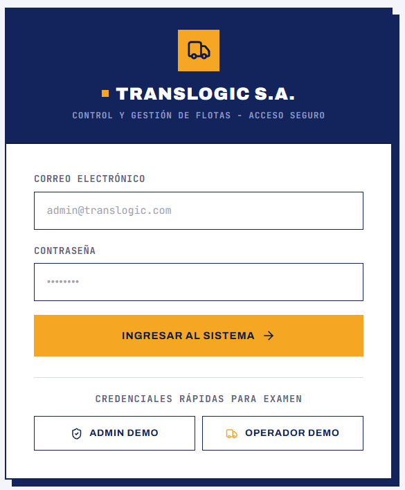
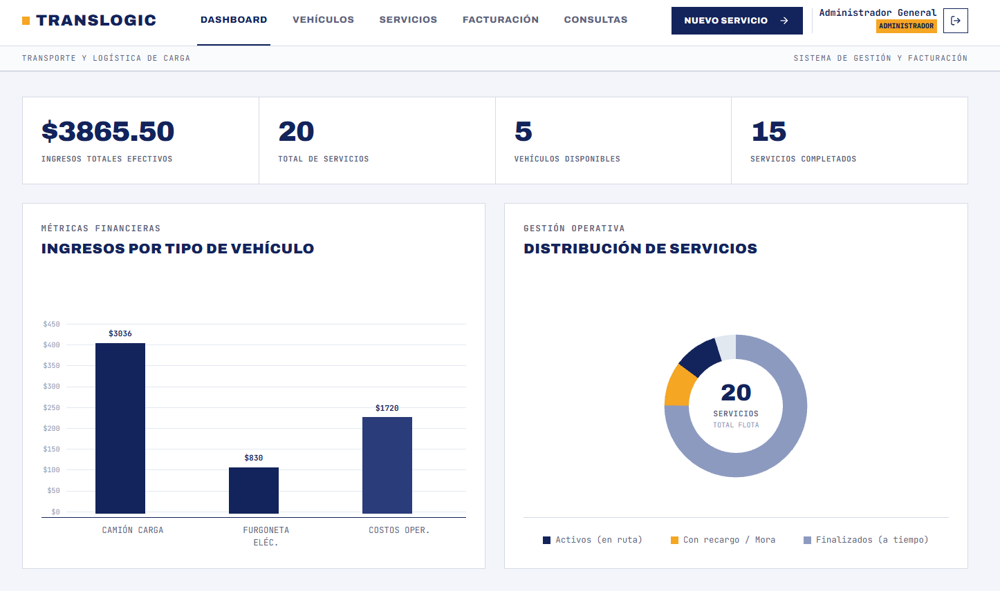
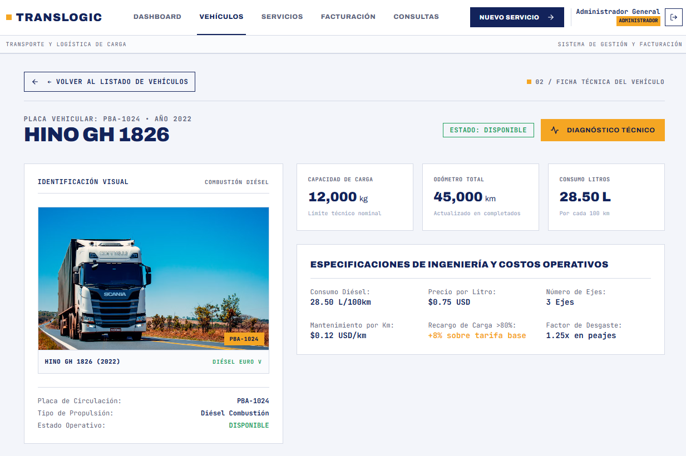
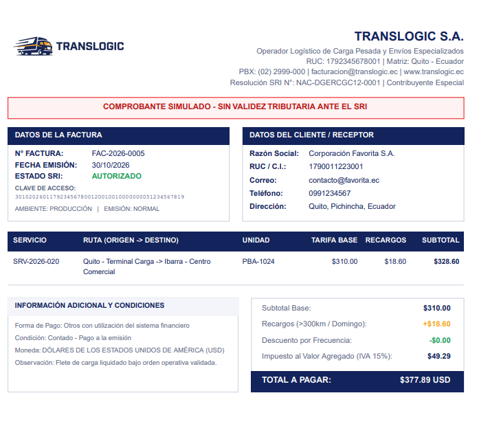
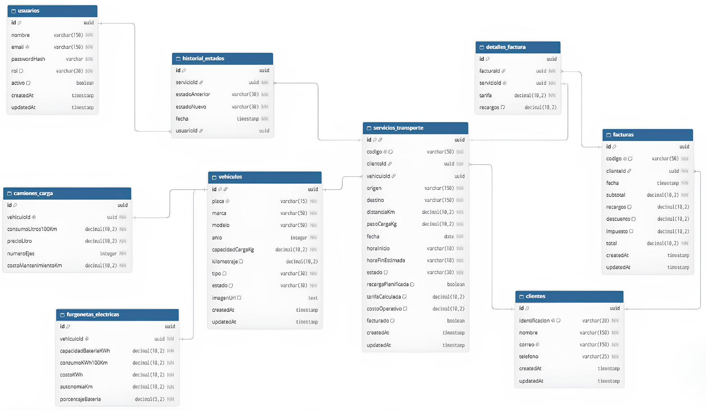

# TRANSLOGIC S.A. - Sistema Inteligente de Gestión de Flotas, Servicios y Facturación
> **Examen Práctico de Programación Móvil - Examen Parcial I**  
> **Estudiante:** Noemí Cajamarca  
> **Repositorio Oficial:** [examen-programacion-movil-translogic](https://github.com/Noemi2005/examen-programacion-movil-translogic)

---

## Tabla de Contenidos
1. [Arquitectura de la Solución (3 Capas)](#1-arquitectura-de-la-solución-3-capas)
2. [Galería Visual y Capturas del Sistema](#2-galería-visual-y-capturas-del-sistema)
3. [Estrategia Git y Ramas](#3-estrategia-git-y-ramas)
4. [Reglas de Negocio Implementadas](#4-reglas-de-negocio-implementadas)
5. [Las 8 Consultas Analíticas en Base de Datos (Req-07)](#5-las-8-consultas-analíticas-en-base-de-datos-req-07)
6. [Justificación Teórica de Seguridad (Req-09)](#6-justificación-teórica-de-seguridad-req-09)
7. [Instrucciones de Instalación y Ejecución](#7-instrucciones-de-instalación-y-ejecución)
8. [Credenciales de Acceso al Sistema](#8-credenciales-de-acceso-al-sistema)

---

## 1. Arquitectura de la Solución (3 Capas)

La solución está construida bajo una estricta **arquitectura en tres capas desacopladas**, garantizando que toda la lógica de negocio y las validaciones críticas se procesen y verifiquen en el servidor:

<p align="center">
  
</p>

### Organización por Capas y Carpetas

#### **Backend (`backend/src/`)**
Estructura modular orientada al dominio con controladores y entidades:
* **Controladores (`/modules/*/controllers`)**:
  * `auth.controller.ts`: Autenticación JWT y login con roles.
  * `vehiculos.controller.ts`: Endpoints CRUD, búsqueda por placa y diagnóstico de eficiencia.
  * `servicios.controller.ts`: Ciclo de vida de servicios, asignación concurrente y simulación de tarifas.
  * `facturas.controller.ts`: Emisión atómica y descarga de comprobantes PDF simulados.
  * `reportes.controller.ts`: Métricas de rentabilidad del dashboard y las 8 consultas analíticas SQL.
* **Entidades (`/database/entities/`)**:
  * `usuario.entity.ts`: Modelo de usuarios con encriptación bcrypt y roles.
  * `cliente.entity.ts`: Modelo de clientes solicitantes de transporte.
  * `vehiculo.entity.ts`, `camion-carga.entity.ts`, `furgoneta-electrica.entity.ts`: Modelado polimórfico con herencia 1 a 1.
  * `servicio-transporte.entity.ts` y `historial-estado.entity.ts`: Registro operativo y auditoría de transiciones.
  * `factura.entity.ts` y `detalle-factura.entity.ts`: Comprobantes contables y prevención de doble facturación.

#### **Frontend (`frontend/src/`)**
Interfaz móvil corporativa moderna con Tailwind CSS y diseño brutalista:
* **Vistas y Componentes Modulares (`/components/`)**:
  * `DashboardView.tsx`: Tarjetas KPI monumentales, gráfico de barras financieras y dona operativa con tooltips interactivos al cursor.
  * `VehiculosView.tsx` y `VehiculoDetalleView.tsx`: Listado de flota, telemetría técnica, fotografía real de la unidad en flota activa y paginación.
  * `VehiculoFormView.tsx` y `VehiculoEficienciaView.tsx`: Creación/edición y evaluación de consumo/autonomía.
  * `ServiciosView.tsx` y `ServicioFormView.tsx`: Despachos, filtro interactivo por estado, buscador combobox en vivo y cotización en tiempo real.
  * `ServicioAsignarView.tsx`: Asignación protegida contra solapamiento y concurrencia.
  * `FacturacionView.tsx` y `FacturaFormView.tsx`: Emisión atómica, desglose contable y liquidación multicliente.
  * `FacturaDetalleModal.tsx`: Visualización integral del comprobante oficial con datos fiscales, despachos asociados, tarifas, recargos e IVA.
  * `TicketPosModal.tsx`: Modal de **Ticket Maquinita POS (80mm)** con código de barras en puro CSS sin dependencias y soporte directo para impresión `window.print()`.
  * `ConsultasView.tsx` y `ConsultaDetalleView.tsx`: Cuadrícula de 8 reportes analíticos con navegación a pantallas completas independientes y exportación CSV.
  * `Pagination.tsx` y `Footer.tsx`: Controles de paginación corporativa y pie de página institucional.

---

## 2. Galería Visual y Capturas del Sistema

A continuación se presentan las capturas oficiales de la interfaz de usuario implementada con diseño corporativo brutalista:

### A. Autenticación y Control de Acceso (Login)
<p align="center">
  
</p>

### B. Dashboard Operativo y Financiero
<p align="center">
  
</p>

### C. Gestión y Listado de Flota Vehicular
<p align="center">
  
</p>

### D. Ficha Técnica y Telemetría del Vehículo
<p align="center">
  
</p>

### E. Emisión de Factura Oficial y Comprobante PDF (Req-04 / Req-08)
<p align="center">
  
</p>

### F. Modelo Entidad-Relación de la Base de Datos (PostgreSQL)
<p align="center">
  
</p>

---

## 3. Estrategia Git y Ramas

El versionamiento del proyecto sigue el estándar **Git Flow**:
* **`main`**: Rama principal estable y de entrega final.
* **`dev`**: Rama integradora de desarrollo continuo.
* **`feature/req-01-backend-database`**: Modelado de datos, TypeORM, entidades y seeders reproducibles.
* **`feature/req-02-03-vehiculos-servicios`**: Tarifas polimórficas, validaciones de carga/batería, control de solapamiento de horarios, auditoría y control de concurrencia.
* **`feature/req-06-08-frontend-mobile`**: Frontend responsivo, cotizador en vivo, liquidación simulada, ticket POS, generación de PDF y dashboard interactivo.
* **`feature/req-08-reportes-pdf-ui`**: Identidad corporativa, alertas interactivas SweetAlert2, edición fotográfica de unidades vehiculares, optimización de comprobantes PDF tipo RIDE SRI y documentación técnica visual.

---

## 4. Reglas de Negocio Implementadas

### A. Tarifas Polimórficas (Req-02)
* **Camión de carga**:
  $$\text{Costo Combustible} = (\text{distancia} / 100) \times \text{consumoLitros100Km} \times \text{precioLitro}$$
  $$\text{Costo Operativo} = \text{Costo Combustible} + (\text{distancia} \times \text{costoMantenimientoKm})$$
  $$\text{Tarifa Base} = \text{Costo Operativo} \times 1.35$$
  *Si el peso de la carga supera el 80% de la capacidad nominal, se añade un **8% de recargo** a la tarifa base.*

* **Furgoneta eléctrica**:
  $$\text{Costo Energético} = (\text{distancia} / 100) \times \text{consumoKWh100Km} \times \text{costoKWh}$$
  $$\text{Tarifa Base} = (\text{Costo Energético} + 18) \times 1.30$$
  *Si la distancia supera el 80% de la autonomía disponible, se añade un **10% de recargo** a la tarifa base.*
  *Se rechaza el despacho si no hay batería suficiente, salvo que se planifique recarga intermedia en ruta.*

### B. Control de Concurrencia y Horarios (Req-03)
* **Solapamiento horario**: Se valida en base de datos que una unidad no tenga otro servicio activo o programado en el intervalo $[\text{horaInicio}, \text{horaFinEstimada}]$ en la misma fecha.
* **Concurrencia con Bloqueo Pesimista**: Al asignar un vehículo, se ejecuta `pessimistic_write` para serializar asignaciones simultáneas y evitar dobles reservas.
* **Actualización Atómica del Odómetro**: Al marcar un servicio como `COMPLETADO`, se actualiza exactamente una vez el kilometraje del vehículo y la batería consumida.

### C. Facturación Atómica y Comprobantes (Req-04)
* Solo se pueden facturar servicios en estado `COMPLETADO` que no hayan sido facturados previamente.
* **Recargo 6%** para servicios de más de 300 km.
* **Recargo 12%** para servicios despachados en día domingo.
* **Descuento por volumen**: **5%** para clientes con 4 o 5 servicios completados; **10%** para más de 5 servicios.
* **Ticket Maquinita POS (80mm)** con código de barras generado en puro CSS sin dependencias externas y soporte para `window.print()`.
* **Comprobante PDF Oficial Simulado** con disclaimer legal obligatorio del SRI (*"Sin validez tributaria ante el SRI"*).

---

## 5. Las 8 Consultas Analíticas en Base de Datos (Req-07)

Todas las consultas se ejecutan directamente en PostgreSQL mediante SQL nativo y optimizado:
1. **01 / Costo supera el promedio**: Servicios cuyo costo operativo supera el promedio general de despachos completados (Subconsulta `AVG`).
2. **02 / Participación por vehículo**: Porcentaje de participación de cada unidad en servicios completados.
3. **03 / Clientes frecuentes**: Clientes con al menos 3 servicios completados en un período (`HAVING COUNT >= 3`).
4. **04 / Vehículos rentables**: Ranking de flota ordenado por utilidad neta y margen porcentual (`ORDER BY utilidad DESC LIMIT 5`).
5. **05 / Vehículos sin servicios en rango**: Unidades sin despachos asignados durante un rango de fechas (`NOT EXISTS`).
6. **06 / Facturación mensual por tipo**: Facturación acumulada agrupada por tipo de unidad y mes.
7. **07 / Eficiencia inferior al promedio**: Vehículos que presentan mayor consumo que el promedio de su misma categoría.
8. **08 / Disminución de facturación > 20%**: Clientes cuya facturación disminuyó más del 20% respecto al mes anterior usando la función ventana analítica `LAG()`.

---

## 6. Justificación Teórica de Seguridad (Req-09)

> ### ¿Por qué validar solo en el frontend no garantiza integridad?
> 1. **Bypass del Cliente**: Cualquier usuario puede evadir los formularios del navegador usando herramientas como Postman, cURL o scripts HTTP, enviando peticiones manipuladas directamente al backend.
> 2. **Transacciones ACID y Concurrencia**: Validaciones críticas como evitar solapamiento de horarios, control de batería o no duplicar facturas exigen bloqueos a nivel de motor de base de datos (`pessimistic_write`) que el frontend es incapaz de garantizar.
> 3. **Consistencia Financiera**: Las tarifas, recargos y descuentos deben recalcularse obligatoriamente en el servidor para evitar fraudes en los montos facturados.

---

## 7. Instrucciones de Instalación y Ejecución

### Requisitos Previos:
* Node.js v18+ o v20+
* PostgreSQL v14+ y pgAdmin
* Git

### Paso 1: Configurar la Base de Datos en pgAdmin
1. Abre **pgAdmin** y conéctate a tu servidor local PostgreSQL.
2. Crea una base de datos llamada: **`translogic_db`**.

### Paso 2: Configurar y Ejecutar el Backend (NestJS)
```powershell
cd backend

# Iniciar la base de datos con el Seeder reproducible completo
npm run seed

# Iniciar servidor backend en desarrollo
npm run start:dev
```
* **API REST:** `http://localhost:3000`
* **Documentación Swagger / OpenAPI:** `http://localhost:3000/api/docs`

### Paso 3: Ejecutar la Suite de Pruebas Automatizadas (Jest)
```powershell
cd backend
npm test
```
*(100% de las 8 pruebas automatizadas pasando con éxito).*

### Paso 4: Ejecutar el Frontend Móvil (Vite + React)
En otra terminal de PowerShell:
```powershell
cd frontend
npm run dev
```
* **Aplicación Web:** `http://localhost:5173`

---

## 8. Credenciales de Acceso al Sistema

El sistema cuenta con dos perfiles de usuario generados automáticamente por el seed:

| Rol | Correo Electrónico | Contraseña | Permisos |
| :--- | :--- | :--- | :--- |
| **ADMINISTRADOR** | `admin@translogic.com` | `Admin123!` | Acceso total: gestión de flota, planificación, facturación, PDF y reportes |
| **OPERADOR** | `operador@translogic.com` | `Operador123!` | Operativa: nuevos despachos, asignación, transiciones de estado y auditoría |
